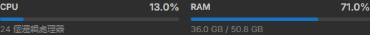
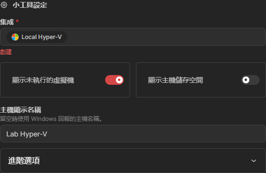

# Homarr Hyper-V Monitor

在 Homarr 顯示 Windows Hyper-V 主機及個別 VM 的 CPU、RAM、狀態與 uptime。
包含獨立的 Windows agent、原生 **Hyper-V integration** 與 **Hyper-V widget**。

這是自行維護的 Homarr 擴充，基於 **Homarr 2.10.1**，不是官方內建功能或可從 Workshop 匯入的 Custom JSX widget。需要使用本專案建置的 Homarr image。

## 功能

- 主機 CPU（包含 guest 負載）、RAM、uptime、執行中 VM 數量。
- 每台 VM 的 CPU、記憶體需求／配置、原始狀態；進階檢視提供 vCPU、Dynamic Memory、啟動／最小／最大 RAM 與 VM ID。
- 可隱藏停止的 VM，並選擇顯示主機的本機磁碟容量。
- 每個 widget 可自行設定 **Host display name／主機顯示名稱**；留空使用 Windows 主機名稱，不會修改 Windows 設定。
- 自動輪詢；連線失敗或資料過期時顯示錯誤，恢復後自動更新。
- 英文及繁體中文介面。

## 畫面

以下是實際執行中的 Homarr 截圖，僅擷取可公開的介面區域；VM 名稱、ID、連線設定與 token 未包含在圖片中。





## 架構

```text
Hyper-V host                         Homarr server
Go agent ───────── HTTPS + token ──> Hyper-V integration ──> Hyper-V widget
  Get-VM + local CIM                   authenticated polling
```

箭頭表示資料流；連線由 Homarr 發起。Agent 只有 `GET /api/v1/snapshot`，不提供啟停 VM 或遠端執行指令。

**Agent 是 Go 編譯的單一 Windows exe**，內嵌 PowerShell 5.1 collector 呼叫 Hyper-V 管理工具。HTTP、token、TLS、排程及設定儲存由 Go 處理，不需要 username/password。安裝程式可建立以 SYSTEM 執行的開機排程，並以 ACL 保護 exe、設定和私鑰。

## 安裝

### 1. Windows agent

從 [Releases](https://github.com/takidog/homarr-hyperV-monitor/releases) 下載 Windows amd64 zip，解壓後在系統管理員終端執行：

```powershell
.\hyperv-monitor.exe configure --bind 127.0.0.1 --port 9276
.\hyperv-monitor.exe
```

第一次設定儲存到 `~/.homarr-hyperv-monitor/config.json`，後續直接執行 exe 即可。預設自動產生 token；也支援 `--token`、`--token-file`、自訂 `--config` 路徑與採樣間隔。

跨機器連線可用 `--generate-tls` 產生對應綁定 IP 的憑證，再將公開的 `server.crt` 放入 Homarr trusted certificates。只開放 Homarr 伺服器來源 IP。確認可連線後，執行 `Install-HyperVAgent.ps1` 安裝開機排程。完整 HTTPS、防火牆、更新、token 輪替及移除方式見 [agent 文件](agent/README.md)。

### 2. Homarr image

先備份原有 Compose 與完整 `/appdata`（SQLite 請停止容器後備份），保留原本的 `SECRET_ENCRYPTION_KEY`、volume、port、network 與其他設定。將 Homarr service 的 image 改為：

```yaml
image: ghcr.io/takidog/homarr-hyperv-monitor:latest
```

正式部署建議改用 Actions 產生的 commit tag 或 image digest 固定版本。提供 `linux/amd64` image。勿使用新的加密金鑰啟動既有資料，否則原有整合憑證無法解密。

```sh
docker compose pull homarr
docker compose up -d --no-deps homarr
```

如需回復，還原原本 image；若已變更資料庫內容則同時還原配對的 `/appdata` 備份。此擴充沒有新增 migration。

### 3. Integration 與 widget

由具有整合管理權限的帳號，在 Homarr 管理區新增 **Hyper-V** integration，填寫 agent 的可連線 origin 和 API key。憑證若由私人 CA 簽發，將 CA 加入 Homarr 的 trusted certificates。測試成功後在面板加入 **Hyper-V** widget，選擇 integration 並填入想顯示的 Host 名稱。每台 Windows host 各建立一個 integration。

## 原始碼與建置

| 位置 | 內容 |
| --- | --- |
| `agent/` | Go exe 原始碼、內嵌 Windows collector、安裝程式 |
| `homarr/overlay/packages/integrations/src/hyperv/` | 驗證 snapshot、token 認證、timeout 與資料新鮮度檢查 |
| `homarr/overlay/packages/widgets/src/hyperv/` | Widget UI 與選項 |
| `homarr/overlay/packages/api/`、`packages/request-handler/` | tRPC 與快取 |
| `homarr/registration.patch` | Homarr 既有註冊點、翻譯及測試 allowlist 的修改 |
| `homarr/upstream.json` | 固定的上游版本與 commit |

需要 Python 3、Git 與支援現代 BuildKit 的 Docker：

```sh
python3 scripts/prepare.py
docker buildx build --load -t homarr-hyperv:local .build/homarr
```

Prepare 會下載固定上游 commit、檢查並套用 patch，再加入 extension 原始碼。目的目錄已存在時會拒絕覆寫。GitHub Actions 使用相同流程建置並發佈 GHCR image；不需要上傳 Windows host 的任何帳密。

## 指標範圍

VM CPU 是該 VM 虛擬處理器的使用率；VM RAM 是 Hyper-V 的 `MemoryDemand / MemoryAssigned`，不是 guest 內 process 的精確加總。沒有需求資料時顯示 unknown，停止的 VM 配置用量是 0。此版本不包含 VM 內檔案系統、VHD 用量、網路／磁碟 I/O 或叢集自動探索。完整語意與故障排除見 [agent 文件](agent/README.md#metrics-and-limitations)。

Apache-2.0；基於 [Homarr](https://github.com/homarr-labs/homarr)。實作使用 AI 協助開發。
