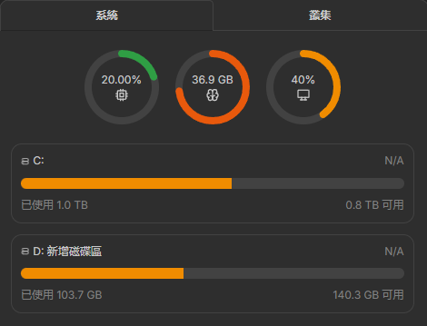
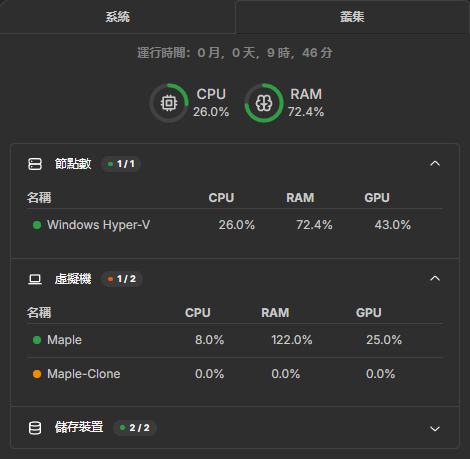
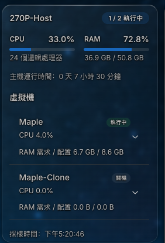

# Homarr Hyper-V Monitor

**Read-only Hyper-V host and VM monitoring for Homarr, including GPU-PV utilization.**

[](https://github.com/takidog/homarr-hyperV-monitor/releases)
[](https://github.com/takidog/homarr-hyperV-monitor/actions/workflows/build.yml)
[](LICENSE)

**English** · [繁體中文](README.zh-TW.md)

A **Hyper-V integration for Homarr's built-in System Health Monitoring widget**, backed by a configurable **Go agent** on Windows. Monitor your host and its VMs without installing agents inside the guests.

<p align="center">
  
  
</p>

<details>
<summary>Optional dedicated Hyper-V widget</summary>

<p align="center">
  
</p>

<p align="center"><sub>Project owner's screenshot of the optional dedicated widget. The recommended view now uses Homarr's built-in System Health Monitoring widget.</sub></p>

</details>

[Quick start](#quick-start) · [GPU-PV monitoring](#gpu-pv-monitoring) · [Agent configuration](agent/README.md) · [Releases](https://github.com/takidog/homarr-hyperV-monitor/releases)

## Features

- **Native Homarr UI:** System tab with host gauges; Cluster tab with host, VM and storage lists, including GPU-PV usage.
- **Host metrics:** CPU including guest workloads, RAM, GPU utilization, uptime and running VM count.
- **Per-VM metrics:** CPU, memory demand and assignment, GPU-PV utilization, state, uptime and configuration details.
- **Custom host names:** rename the integration to name the host in the native widget. The optional dedicated widget also has a per-widget host name.
- **Flexible layout:** native compact and advanced views, configurable cluster sections, English and Traditional Chinese UI. The dedicated widget remains compatible with existing boards.
- **Standalone Windows agent:** one Go exe with persisted CLI settings, bearer-token authentication, HTTPS and optional automatic startup.
- **Fresh data:** automatic polling, timeouts and explicit unavailable states instead of presenting stale values as current.

## Requirements

| Component | Requirement |
| --- | --- |
| Windows host | Hyper-V role, Hyper-V PowerShell management tools, Windows PowerShell 5.1 and administrative access |
| GPU monitoring | WDDM GPU Engine counters; per-VM readings additionally require GPU-PV and counters attributed to the VM worker process |
| Homarr | This project's custom image, based on **Homarr 2.10.1**; published for `linux/amd64` |
| Agent binary | Windows `amd64`; no Go runtime or separate collector script required |

This is an independent extension, not an official Homarr integration or a Workshop import. The integration adapter must be built into Homarr; stock Homarr does not yet include this extension.

## Quick start

### 1. Configure the Windows agent

Download the Windows amd64 zip from [Releases](https://github.com/takidog/homarr-hyperV-monitor/releases), extract it and open an elevated terminal:

```powershell
.\hyperv-monitor.exe configure --bind 127.0.0.1 --port 9276
.\hyperv-monitor.exe
```

Settings are saved to `~/.homarr-hyperv-monitor/config.json`. Later launches need no arguments. A random token is generated automatically; `--token` and `--token-file` let you supply your own. The agent uses no username/password login.

The default listener is local-only. For a separate Homarr server, use a reachable IP and HTTPS:

```powershell
# Replace this documentation address with the Windows host's actual IP.
.\hyperv-monitor.exe configure --force --bind 192.0.2.10 --port 9276 --generate-tls
.\hyperv-monitor.exe
```

Copy **only `server.crt`** to Homarr's `/appdata/trusted-certificates/` and restart Homarr. Keep `config.json` and `server.key` private. Restrict the Windows firewall to the Homarr server's source IP. See the [agent guide](agent/README.md#https-across-machines) for existing certificates, firewall examples and token management.

After checking the connection, stop the foreground agent and install automatic startup:

```powershell
.\Install-HyperVAgent.ps1
```

The scheduled task runs as SYSTEM and reads a protected copy of the configuration in `%ProgramData%\Homarr Hyper-V Agent`. Updating the home-directory config does not change that installed copy; use the [update instructions](agent/README.md#start-automatically).

### 2. Run Homarr with the extension

Back up your Compose file and `/appdata` first. For SQLite, use an online SQLite backup or stop Homarr for a consistent file backup. Preserve the existing encryption key, volumes, ports, networks and other environment settings. Change only the Homarr service image:

```yaml
image: ghcr.io/takidog/homarr-hyperv-monitor:latest
```

```sh
docker compose pull homarr
docker compose up -d --no-deps homarr
```

Pin a commit tag or image digest in production. Replacing `SECRET_ENCRYPTION_KEY` prevents Homarr from decrypting existing integration credentials. This extension adds no database migration; keep the old image and matching backup for rollback.

### 3. Connect the widget

In Homarr, create a **Hyper-V** integration with the agent's reachable origin and the `token` from its config. Then add the built-in **System Health Monitoring** widget and select that integration. Create one integration per host and use its name as the host display name.

- **System:** CPU, RAM and available host GPU gauges, plus local storage.
- **Cluster:** the host and individual VMs, with CPU, RAM and GPU-PV usage; click a row for details. Hide **LXCs** in the visible cluster sections for Hyper-V.

Agent **v0.2.0** already supplies these metrics; this UI update needs no agent reinstall. Existing dedicated Hyper-V widgets continue to work, including their per-widget host names and additional VM configuration details.

The account needs permission to create integrations and use the chosen integration. If the Integrations section is missing, check its group permissions. A container's `localhost` refers to the container, not the Windows host.

## GPU-PV monitoring

The agent reads Windows **GPU Engine** counters and maps their process IDs to Hyper-V VM worker processes through `Msvm_ComputerSystem.ProcessID`. It adds process/context activity on the **same physical engine**, then reports the busiest engine. Independent engines and GPUs are not added together.

- **Host GPU:** the busiest physical GPU engine across the host, including guest workloads.
- **VM GPU:** activity attributed to that VM's worker process; a share of physical-engine utilization, **not** utilization of its assigned GPU partition quota.
- **Unavailable:** missing VM counters or an unmatched worker process display `—`, not a fabricated zero. The native host gauge is hidden when GPU counters are unavailable; unreported VRAM is omitted. GPU probe failures leave CPU/RAM collection available.
- **Stopped VMs:** configured GPU-PV adapters remain visible in details; off/saved VMs report 0% GPU. VMs without GPU-PV adapters do not show a GPU usage field.

Counter availability and attribution depend on Windows and the driver. This was verified on a Windows Hyper-V host with GPU-PV. It does not claim GPU passthrough/DDA monitoring or per-VM VRAM accounting. GPU Engine counters are integer percentages; small per-context loads may be rounded down.

References: [Microsoft's GPU utilization model](https://devblogs.microsoft.com/directx/gpus-in-the-task-manager/), [GPU paravirtualization](https://learn.microsoft.com/en-us/windows-hardware/drivers/display/gpu-paravirtualization), [VM worker process mapping](https://learn.microsoft.com/en-us/windows/win32/hyperv_v2/msvm-computersystem).

## Metric semantics and limits

VM CPU is relative to its assigned virtual processors. VM RAM is Hyper-V's `MemoryDemand / MemoryAssigned`, not an exact sum of guest processes. Unknown demand displays `—`; stopped VMs retain their startup-memory configuration while assigned memory is zero.

Host storage covers local fixed volumes. Guest filesystems, VHD usage, network/disk I/O, persistent history and Failover Cluster discovery are outside the current scope. The API is read-only and provides no VM control or remote command endpoint. See [metric details and troubleshooting](agent/README.md#metrics-and-limitations).

## Build from source

The agent embeds its PowerShell collector; HTTP, authentication, configuration, TLS, scheduling and timeouts are implemented in Go.

```powershell
# On Windows, with Go 1.25 or newer
cd agent
go test ./...
go vet ./...
go build -trimpath -ldflags '-s -w -X main.version=0.2.0' -o hyperv-monitor.exe .
```

For Homarr, install Python 3, Git and Docker with modern BuildKit:

```sh
python3 scripts/prepare.py
docker buildx build --load -t homarr-hyperv:local .build/homarr
```

`prepare.py` fetches the pinned upstream commit, checks and applies the registration patch, then copies the extension source. It refuses to overwrite an existing destination. GitHub Actions publishes images using the same build process.

| Path | Contents |
| --- | --- |
| `agent/` | Go agent, embedded collector and startup installer |
| `homarr/overlay/packages/integrations/src/hyperv/` | Snapshot validation, authenticated client and native health adapters |
| `homarr/overlay/packages/widgets/src/hyperv/` | Optional dedicated widget and options |
| `homarr/overlay/packages/api/` | tRPC endpoint |
| `homarr/overlay/packages/request-handler/` | Request cache |
| `homarr/registration.patch` | Registrations, translations and existing test allowlist changes |
| `homarr/upstream.json` | Pinned Homarr version and commit |

## Contributing

Bug reports and focused pull requests are welcome. Include Windows/driver versions, agent version and expected versus actual behavior. Redact tokens, private keys and private infrastructure details from logs and screenshots. For GPU issues, distinguish host readings from individual VM readings and identify whether GPU-PV is configured.

## License

[Apache-2.0](LICENSE). Built on [Homarr](https://github.com/homarr-labs/homarr); see [NOTICE](NOTICE). Developed with AI assistance.
