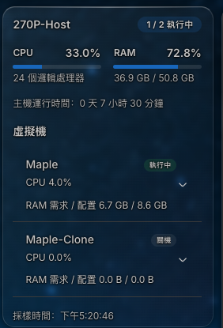

# Homarr Hyper-V Monitor

**在 Homarr 監測 Hyper-V 主機與個別 VM，包含 GPU-PV 使用率。**

[](https://github.com/takidog/homarr-hyperV-monitor/releases)
[](https://github.com/takidog/homarr-hyperV-monitor/actions/workflows/build.yml)
[](LICENSE)

[English](README.md) · **繁體中文**

原生 **Hyper-V integration 與 widget**，搭配 Windows 上可設定的 **Go agent**。從主機取得各 VM 的資源使用情況，不需要在 guest 內另外安裝 agent。

<p align="center">
  
</p>

<p align="center"><sub>專案作者提供的 v0.1 截圖；v0.2 在此版面加入 GPU 讀值。</sub></p>

[快速開始](#快速開始) · [GPU-PV 監測](#gpu-pv-監測) · [Agent 設定](agent/README.md) · [下載](https://github.com/takidog/homarr-hyperV-monitor/releases)

## 功能

- **主機指標：** CPU（包含 guest 負載）、RAM、GPU 使用率、uptime 與執行中的 VM 數量。
- **個別 VM：** CPU、記憶體需求／配置、GPU-PV 使用率、狀態、uptime 與配置細節。
- **自訂 Host 名稱：** 每個 widget 可獨立命名，留空時使用 Windows 主機名稱。
- **顯示選項：** 精簡／進階檢視、隱藏停止的 VM、選擇顯示主機磁碟容量；支援英文與繁體中文。
- **獨立 Windows agent：** 單一 Go exe，CLI 設定保存、token 認證、HTTPS 與可選的開機啟動。
- **資料新鮮度：** 自動輪詢、逾時及 unavailable 狀態，不將過期數值當成目前用量。

## 需求

| 元件 | 需求 |
| --- | --- |
| Windows 主機 | Hyper-V、Hyper-V PowerShell 管理工具、Windows PowerShell 5.1 及系統管理員權限 |
| GPU 監測 | WDDM GPU Engine 計數器；個別 VM 還需要 GPU-PV 與可歸屬到 VM worker process 的計數器 |
| Homarr | 本專案自訂 image，基於 **Homarr 2.10.1**，提供 `linux/amd64` |
| Agent | Windows `amd64`；不需要 Go runtime 或獨立的 collector 腳本 |

這是獨立維護的擴充，不是 Homarr 官方整合，也不是可從 Workshop 匯入的 widget。原生 integration 與 widget 必須一同建置進 Homarr。

## 快速開始

### 1. 設定 Windows agent

從 [Releases](https://github.com/takidog/homarr-hyperV-monitor/releases) 下載 Windows amd64 zip，解壓後在系統管理員終端執行：

```powershell
.\hyperv-monitor.exe configure --bind 127.0.0.1 --port 9276
.\hyperv-monitor.exe
```

設定儲存於 `~/.homarr-hyperv-monitor/config.json`，後續直接執行 exe 即可。預設自動產生隨機 token，也支援 `--token` 或 `--token-file` 自行指定，不需要 username/password。

預設僅允許本機連線。Homarr 在另一台機器時，使用可連線的 IP 與 HTTPS：

```powershell
# 將文件範例位址替換成 Windows 主機的實際 IP。
.\hyperv-monitor.exe configure --force --bind 192.0.2.10 --port 9276 --generate-tls
.\hyperv-monitor.exe
```

**只將 `server.crt`** 複製到 Homarr 的 `/appdata/trusted-certificates/`，再重新啟動 Homarr。`config.json` 與 `server.key` 必須保密。Windows 防火牆僅開放 Homarr 伺服器的來源 IP。既有憑證、防火牆範例及 token 管理見 [agent 文件](agent/README.md#https-across-machines)。

確認連線後，停止前景執行的 agent，再安裝開機啟動：

```powershell
.\Install-HyperVAgent.ps1
```

排程以 SYSTEM 執行，使用 `%ProgramData%\Homarr Hyper-V Agent` 內受保護的設定副本。修改家目錄的設定不會直接影響已安裝副本；請參閱 [更新方式](agent/README.md#start-automatically)。

### 2. 使用包含擴充的 Homarr image

先備份 Compose 與 `/appdata`。SQLite 可用線上備份，或停止 Homarr 後複製檔案，以確保一致性。保留既有加密金鑰、volumes、ports、networks 及其他環境設定，只修改 Homarr service 的 image：

```yaml
image: ghcr.io/takidog/homarr-hyperv-monitor:latest
```

```sh
docker compose pull homarr
docker compose up -d --no-deps homarr
```

正式環境請固定 commit tag 或 image digest。更換 `SECRET_ENCRYPTION_KEY` 會讓原本的 integration 憑證無法解密。本擴充沒有新增資料庫 migration；保留舊 image 與配對備份，供需要時回復。

### 3. 連接 widget

在 Homarr 建立 **Hyper-V** integration，填入 agent 可連線的 origin，以及設定檔中的 `token`。加入 **Hyper-V** widget、選擇 integration，再設定需要的 **主機顯示名稱**。每台 host 使用各自的 integration。

帳號必須有建立 integration 及使用該 integration 的權限。如果管理區沒有「整合」，請檢查群組權限。容器裡的 `localhost` 指的是容器，不是 Windows 主機。

## GPU-PV 監測

Agent 讀取 Windows **GPU Engine** 計數器，以 `Msvm_ComputerSystem.ProcessID` 對應 Hyper-V 的 VM worker process。先合計**同一實體 engine** 的各個 process/context，再取最忙碌 engine 的使用率，不將不同 engine 或多張 GPU 的百分比相加。

- **主機 GPU：** 主機所有 GPU 中，最忙碌實體 engine 的用量，包含 guest 負載。
- **VM GPU：** 歸屬於該 VM worker process 的活動；是實體 engine 使用率，**不是 GPU 分割區配額使用率**。
- **無法取得：** 驅動計數器缺失或 worker process 無法對應時顯示 `—`，不假造 0%。GPU 偵測失敗不影響 CPU／RAM 採集。
- **停止的 VM：** 配置的 GPU-PV 配接器數量仍保留；Off／Saved VM 的 GPU 用量為 0%。沒有 GPU-PV 配接器的 VM 不顯示 GPU 使用率欄位。

計數器是否可用及如何歸屬取決於 Windows 與驅動程式，已在具有 GPU-PV 的 Windows Hyper-V 主機驗證。本功能不宣稱支援 DDA 直通 GPU 或每台 VM 的 VRAM 用量。GPU Engine 計數器是整數百分比，個別 context 的微小用量可能向下取整。

參考：[Microsoft GPU 使用率說明](https://devblogs.microsoft.com/directx/gpus-in-the-task-manager/)、[GPU paravirtualization](https://learn.microsoft.com/en-us/windows-hardware/drivers/display/gpu-paravirtualization)、[VM worker process 對應](https://learn.microsoft.com/en-us/windows/win32/hyperv_v2/msvm-computersystem)。

## 指標語意與範圍

VM CPU 相對於該 VM 配置的虛擬處理器。VM RAM 為 Hyper-V 的 `MemoryDemand / MemoryAssigned`，不是 guest process 記憶體的精確加總。未知需求顯示 `—`；停止的 VM 配置用量為 0，但仍顯示啟動記憶體設定。

主機磁碟僅包含本機固定磁碟區。目前不包含 guest 檔案系統、VHD 用量、網路／磁碟 I/O、歷史圖表與 Failover Cluster 探索。API 僅供讀取，不提供 VM 控制或遠端指令。詳見 [指標說明與故障排除](agent/README.md#metrics-and-limitations)。

## 從原始碼建置

Agent 內嵌 PowerShell collector；HTTP、認證、設定、TLS、排程與逾時由 Go 實作。

```powershell
# Windows，需要 Go 1.25 或更新版本
cd agent
go test ./...
go vet ./...
go build -trimpath -ldflags '-s -w -X main.version=0.2.0' -o hyperv-monitor.exe .
```

Homarr 建置需要 Python 3、Git 與支援現代 BuildKit 的 Docker：

```sh
python3 scripts/prepare.py
docker buildx build --load -t homarr-hyperv:local .build/homarr
```

`prepare.py` 下載固定的上游 commit、檢查並套用註冊 patch，再加入擴充原始碼。目的目錄已存在時會拒絕覆寫。GitHub Actions 使用相同流程發佈 image。

| 路徑 | 內容 |
| --- | --- |
| `agent/` | Go agent、內嵌 collector、開機排程安裝程式 |
| `homarr/overlay/packages/integrations/src/hyperv/` | Snapshot 驗證與認證 HTTP client |
| `homarr/overlay/packages/widgets/src/hyperv/` | 原生 widget 與選項 |
| `homarr/overlay/packages/api/` | tRPC endpoint |
| `homarr/overlay/packages/request-handler/` | 請求快取 |
| `homarr/registration.patch` | 註冊點、翻譯、既有測試 allowlist 修改 |
| `homarr/upstream.json` | 固定 Homarr 版本及 commit |

## 貢獻

歡迎回報問題及提交範圍明確的 PR。請提供 Windows／驅動版本、agent 版本，以及預期與實際行為。移除 log 與截圖中的 token、私鑰及私人基礎設施資訊。GPU 問題請區分 host 與個別 VM 的讀值，並說明是否使用 GPU-PV。

## 授權

[Apache-2.0](LICENSE)。基於 [Homarr](https://github.com/homarr-labs/homarr)，見 [NOTICE](NOTICE)。開發過程使用 AI 協助。
